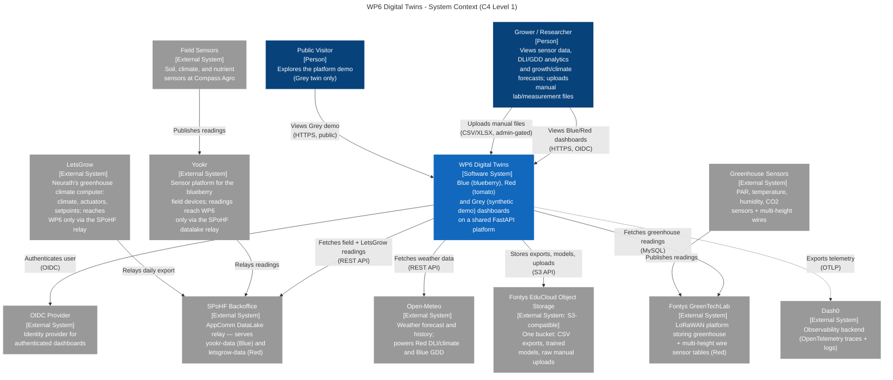
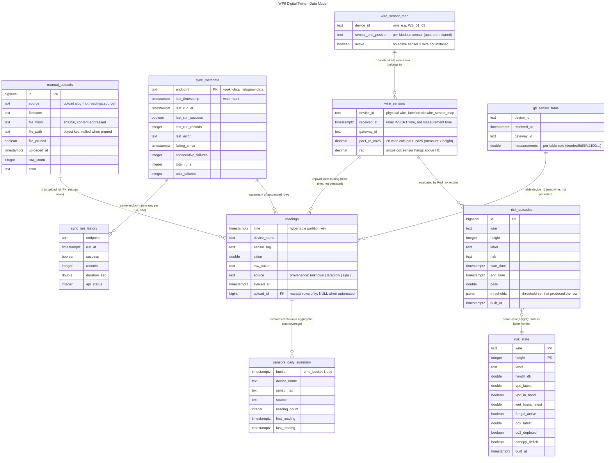

# WP6 Digital Twins in the context of SPoHF

## C4 architecture (current state)

The diagrams below describe the current implementation, reverse-engineered from
the codebase. They follow the [C4 model](https://c4model.com/): each level zooms
one step deeper, from the system in its environment down to the components inside
the codebase and how they're deployed.

The source files live in [`diagrams/`](diagrams/) and are validated by rendering
them with [`mmdc`](https://github.com/mermaid-js/mermaid-cli). Each `.mmd` file is
the single source of truth — the embedded copies below are kept in sync manually.

### System context (C4 L1)

How WP6 fits into its environment: who uses it and which external systems it
integrates with. Note that growers/researchers also *upload* manual measurement
files (lab long-data, insect counts, Sijia phenotyping), greenhouse readings
come from the Fontys GreenTechLab platform (MySQL), and Open-Meteo powers Red's
DLI and climate models and Blue's GDD analytics. The SPoHF relay now serves two
upstreams: Yookr (Blue's field sensors) and LetsGrow, the greenhouse's own climate
computer (Red). Exports, trained models and raw uploads are stored in an external
S3-compatible object store. The dashboards send traces to Dash0.

### Container view (C4 L2)

The deployable units — three dashboards (Blue, Red, Grey), the two sync and two
export CronJobs, and the data stores — and how they communicate. Note that DLI
and the climate model run inside the Red dashboard process (not a separate
container), and the shared platform is shown as a library that every dashboard is
built from. The TimescaleDB instance is **shared** and holds one database per twin
(`wp6_blue`, `wp6_red`). Red reads its *live* greenhouse and wire feed from MySQL.
LetsGrow rows, manual uploads and risk episodes go to `wp6_red`.

There are **no PVCs on the dashboards any more**: CSV exports, trained models and
raw manual uploads all live in one S3 bucket, separated by key prefix
(`{twin}/exports`, `{twin}/models`, `{twin}/manual-uploads`). That is what lets
the dashboards roll out without downtime (issue 061). The export jobs write CSVs
to the bucket and the dashboards read them back. Models are refit nightly
*inside* the dashboard process ([ADR 0007](../adr/0007-trained-models-persist-and-are-fingerprinted.md)),
not by a CronJob.

```mermaid
---
title: "WP6 Digital Twins - Container Diagram (C4 Level 2)"
---
graph TB
    %% SSOT — also embedded in docs/architecture/index.md.
    %% Edit this file first, then mirror into index.md.
    classDef person fill:#08427b,color:#fff,stroke:none
    classDef container fill:#1168bd,color:#fff,stroke:none
    classDef database fill:#1168bd,color:#fff,stroke:none
    classDef external fill:#999,color:#fff,stroke:none
    classDef cronjob fill:#438dd5,color:#fff,stroke:none
    classDef shared fill:#0a3d62,color:#fff,stroke:none

    grower["Grower / Researcher
    [Person]"]:::person
    visitor["Public Visitor
    [Person]"]:::person

    subgraph wp6["WP6 Digital Twins"]
        direction TB

        subgraph platform["Shared Platform (wp6_data.shared)"]
            app_factory["App Factory
            [Library: FastAPI + Jinja2]
            Builds a dashboard from a
            TwinConfig; hosts the generic
            manual-ingest pipeline, blob
            store and nightly scheduler"]:::shared
        end

        subgraph blue_twin["Blue Twin (Blueberries)"]
            blue_dash["Blue Dashboard
            [Container: FastAPI]
            Chart compare, GDD tracker,
            soil forecast (nightly refit),
            harvest, manual uploads"]:::container
        end

        subgraph red_twin["Red Twin (Tomatoes)"]
            red_dash["Red Dashboard
            [Container: FastAPI]
            DLI light + climate models
            (nightly refit), multi-height
            wires, risk, crop cycles, Sijia"]:::container
        end

        subgraph grey_twin["Grey Twin (Demo)"]
            grey_dash["Grey Dashboard
            [Container: FastAPI]
            Public demo with synthetic
            in-memory sensor data —
            exercises the shared platform"]:::container
        end

        subgraph data_engine["Data Engine"]
            sync_job["Datalake Sync Job
            [Container: Python CronJob]
            yookr-data → wp6_blue
            (every 15 min)"]:::cronjob

            letsgrow_sync["LetsGrow Sync Job
            [Container: Python CronJob]
            letsgrow-data → wp6_red
            (hourly)"]:::cronjob

            blue_export["Blue CSV Export Job
            [Container: Python CronJob]
            Nightly export of Blue
            sensor data to CSV"]:::cronjob

            red_export["Red CSV Export Job
            [Container: Python CronJob]
            Nightly export of Red
            sensor + wire data to CSV"]:::cronjob
        end

        subgraph tsdb_inst["Shared TimescaleDB [PostgreSQL 17]"]
            tsdb_blue[("wp6_blue
            [Database]
            readings, manual_uploads,
            sync_metadata, sync_run_history")]:::database
            tsdb_red[("wp6_red
            [Database]
            readings (LetsGrow + Sijia),
            manual_uploads, sync_*,
            risk_episodes, risk_state")]:::database
        end
    end

    objstore[("Object Storage
    [External: S3-compatible bucket]
    red/ + blue/ prefixes:
    exports | models | manual-uploads")]:::external

    mysqldb[("MySQL
    [External Database: MySQL 8]
    Fontys GreenTechLab — greenhouse
    tables, wire_sensors,
    wire_sensor_map (Red live feed)")]:::external

    spohf["SPoHF Backoffice
    [External: REST API]
    yookr-data | letsgrow-data"]:::external
    openmeteo["Open-Meteo
    [External: REST API]"]:::external
    oidc["OIDC Provider
    [External: HTTPS]"]:::external
    dash0["Dash0
    [External: OTLP]"]:::external

    %% User flows
    grower -->|"HTTPS\n(OIDC)"| blue_dash
    grower -->|"HTTPS\n(OIDC)"| red_dash
    visitor -->|"HTTPS\n(public)"| grey_dash

    %% Auth flow
    blue_dash -.->|"OIDC"| oidc
    red_dash -.->|"OIDC"| oidc

    %% Platform composition (each dashboard IS a configured app_factory)
    blue_dash -.->|"built from"| app_factory
    red_dash -.->|"built from"| app_factory
    grey_dash -.->|"built from"| app_factory

    %% Blue data access
    blue_dash -->|"Async queries\n(psycopg3 pool)"| tsdb_blue
    blue_dash -->|"Daily weather\n(HTTPS, GDD)"| openmeteo
    blue_dash -->|"Models, uploads,\nreads exports (S3)"| objstore

    %% Red data access (live feed from MySQL; LetsGrow, manual + risk in TSDB)
    red_dash -->|"Async queries\n(aiomysql, live feed)"| mysqldb
    red_dash -->|"LetsGrow, manual, risk\n(psycopg3 pool)"| tsdb_red
    red_dash -->|"Forecast + archive\n(HTTPS, DLI/climate)"| openmeteo
    red_dash -->|"Models, uploads,\nreads exports (S3)"| objstore
    %% grey_dash has no datastore (in-memory)

    %% Sync jobs (one Feed per relay endpoint; bisects windows past the 10k cap)
    sync_job -->|"Paginated fetch\n(httpx)"| spohf
    sync_job -->|"Batch upsert"| tsdb_blue
    letsgrow_sync -->|"Paginated fetch\n(httpx)"| spohf
    letsgrow_sync -->|"Batch upsert\n(source=letsgrow)"| tsdb_red

    %% Export jobs
    blue_export -->|"Read readings"| tsdb_blue
    blue_export -->|"Write CSVs"| objstore
    red_export -->|"Read sensor + wire tables"| mysqldb
    red_export -->|"Read readings"| tsdb_red
    red_export -->|"Write CSVs"| objstore

    %% Observability (Dash0 operator auto-instruments the dashboards)
    blue_dash -.->|"traces"| dash0
    red_dash -.->|"traces"| dash0
    grey_dash -.->|"traces"| dash0
```

### Component view (C4 L3)

Inside the codebase. The shared platform (`wp6_data.shared`) defines a
`SensorDataProvider` Protocol; each twin (`wp6_data.blue`, `wp6_data.red`,
`wp6_data.grey`) provides an implementation plus a `TwinConfig`, and
`create_app(config)` assembles the FastAPI dashboard. Twin-specific features
(DLI and the wire **risk engine** for Red, GDD and soil forecasting for Blue)
attach as `extra_routers`. Several cross-cutting subsystems live in the shared
platform:

- a generic **manual-ingest pipeline** (`ManualSource` descriptor, transactional
  `ManualIngestService`, content-addressed `UploadStorage`). Blue (insects,
  long-data, fertigation) and Red (Sijia) plug their CSV/XLSX sources into it.
- a twin-agnostic `OpenMeteoClient`, used by Red's light and climate models and
  Blue's GDD tracker.
- a `BlobStore` protocol (S3, or local disk in dev). Twins scope it by key prefix
  and use it for exports, uploads and pickled, fingerprinted model `artifacts`.
- `run_daily` for the in-process nightly refit, an object-store health and
  certificate check on the status page, and env-gated OpenTelemetry tracing.

Red's provider is **federated**: it routes each request by sensor tag, either to
MySQL (greenhouse and wire tables) or to `wp6_red` (LetsGrow `lg_*`, Sijia). Which
wires exist comes from upstream's `wire_sensor_map`. Sync is driven by a `Feed`
registry that maps each relay endpoint to its twin's database (`yookr-data` →
`wp6_blue`, `letsgrow-data` → `wp6_red`).

```mermaid
---
title: "WP6 Digital Twins - Component Diagram (C4 Level 3)"
---
graph TB
    %% SSOT — also embedded in docs/architecture/index.md.
    %% Edit this file first, then mirror into index.md.
    classDef component fill:#438dd5,color:#fff,stroke:none
    classDef platform fill:#0a3d62,color:#fff,stroke:none
    classDef protocol fill:#8e44ad,color:#fff,stroke:none
    classDef database fill:#1168bd,color:#fff,stroke:none
    classDef external fill:#999,color:#fff,stroke:none

    %% ── External systems ──
    spohf_api["SPoHF REST API
    [External]
    yookr-data | letsgrow-data"]:::external
    openmeteo_api["Open-Meteo API
    [External]"]:::external
    oidc_provider["OIDC Provider
    [External]"]:::external
    otlp_backend["Dash0
    [External, OTLP]"]:::external
    tsdb_blue[("TimescaleDB wp6_blue
    readings | manual_uploads
    sync_metadata | sync_run_history
    sensors_daily_summary")]:::database
    tsdb_red[("TimescaleDB wp6_red
    readings | manual_uploads | sync_*
    risk_episodes | risk_state")]:::database
    mysqldb[("MySQL
    GTL greenhouse tables, wire_sensors,
    wire_sensor_map (Red live feed)")]:::database
    objstore[("Object Storage bucket
    [S3, per-twin key prefixes]")]:::external

    %% ────────────────────────────────────────────────
    %% Shared Platform — the heart of the application
    %% ────────────────────────────────────────────────
    subgraph platform["Shared Platform (wp6_data.shared)"]
        app_factory["create_app
        [Component]
        Builds FastAPI app from
        TwinConfig: routes, auth,
        provider dispatch, lifespan"]:::platform

        twin_config["TwinConfig
        [Dataclass]
        twin_id, title, theme, data_sources,
        metadata, export_store, manual_sources,
        extra_routers, hero_cards, status_extras,
        require_auth, lifespan hooks"]:::platform

        provider_protocol["SensorDataProvider
        [Protocol]
        fetch_data, fetch_available_sensors,
        fetch_device_data, fetch_manual_metadata,
        fetch_sync_metrics, fetch_daily_coverage"]:::protocol

        shared_routes["Shared Routes
        [Component]
        home | charts | dashboard_page
        status | api | health"]:::platform

        auth_mod["Auth (OIDC)
        [Component]
        startup_oidc, make_auth_router,
        verify_session_user/admin"]:::platform

        metadata_mod["MetadataRegistry
        [Component]
        Loads metadata.yaml:
        device + sensor labels, units"]:::platform

        subgraph manual_ingest["Manual Ingest (shared.manual_ingest)"]
            mi_source["ManualSource
            [Descriptor]
            slug, categorical_value,
            parse, validate, replace_scope"]:::platform
            mi_service["ManualIngestService
            [Component]
            Transactional validate/apply:
            delete prior + audit + insert"]:::platform
            mi_routes["make_source_router / make_card
            [Component]
            Admin-gated preview | apply | history"]:::platform
            mi_cli["run_ingest (CLI)
            [Component]
            Headless validate + apply"]:::platform
        end

        subgraph storage_layer["Storage + lifecycle"]
            blob_store["BlobStore
            [Protocol]
            put | get | try_get | list | delete;
            S3BlobStore, LocalBlobStore,
            PrefixedBlobStore via make_store"]:::protocol
            upload_storage["UploadStorage
            [Component]
            SHA256-addressed keys,
            keeps latest 2 per source"]:::platform
            artifacts["artifacts
            [Component]
            Pickled model artifacts +
            fingerprint gate (ADR 0007)"]:::platform
            scheduling["scheduling.run_daily
            [Component]
            In-process nightly refit clock"]:::platform
            store_health["object_store_health
            [Component]
            Reachability + TLS cert expiry
            card on the status page"]:::platform
        end

        weather["OpenMeteoClient
        [Component]
        Twin-agnostic forecast +
        archive (DLI, climate, GDD)"]:::platform

        telemetry["telemetry / observability
        [Component]
        Env-gated OpenTelemetry tracing,
        log-trace correlation"]:::platform

        misc_shared["templates | aggregation | series
        charts | export | time | cycles
        waterfall | sensor_summary | compat
        [Components]"]:::platform
    end

    %% ────────────────────────────────────────────────
    %% Blue Twin
    %% ────────────────────────────────────────────────
    subgraph blue_layer["Blue Twin (wp6_data.blue)"]
        blue_config["dashboard.config
        [TwinConfig instance]
        1 DataSource: spohf-datalake"]:::component
        blue_provider["BlueSensorProvider
        [Component]
        TSDB-backed, unfiltered"]:::component
        blue_deps["deps / tsdb
        [Component]
        wp6_blue queries + schema;
        blue/ blob stores"]:::component
        blue_routes_x["Blue Extra Routes
        [Components]
        ops | api | charts | gdd | monitor
        (soil, microclimate, light, harvest,
        mixed_views, broken_sensors)"]:::component
        blue_gdd["gdd
        [Component]
        Growing Degree Days from
        Open-Meteo modeled weather"]:::component
        blue_soil["soil_forecaster
        [Component]
        Ridge soil moisture/temp
        7d + 30d forecast"]:::component
        blue_manual["manual sources
        [ManualSource x3]
        insects | long_data |
        fertigation_events"]:::component
        blue_metadata[("blue/metadata.yaml")]:::component
    end

    %% ────────────────────────────────────────────────
    %% Red Twin
    %% ────────────────────────────────────────────────
    subgraph red_layer["Red Twin (wp6_data.red)"]
        red_config["dashboard.config
        [TwinConfig instance]
        1 DataSource: mysql (live feed)"]:::component
        red_provider["RedSensorProvider
        [Component]
        Federated: routes by sensor tag to
        MySQL or wp6_red (LetsGrow, Sijia)"]:::component
        red_db["MySQLConnection
        [Component]
        aiomysql pool, sensor +
        wire table mapping"]:::component
        red_tsdb["deps / tsdb
        [Component]
        wp6_red schema + queries;
        red/ blob stores"]:::component
        red_routes_x["Red Extra Routes
        [Components]
        browse | charts | dli | dli_model
        climate_model | climate_forecast
        multi_height | crop_cycles | sijia"]:::component
        red_sijia["sijia
        [ManualSource]
        Excel phenotyping upload
        (source='sijia')"]:::component
        red_letsgrow["letsgrow
        [Component]
        Relay row → (letsgrow-* device,
        lg_* sensor), source='letsgrow'"]:::component
        red_metadata[("red/metadata.yaml")]:::component
        red_wires["wires
        [Component]
        Installed wires from upstream
        wire_sensor_map (views, risk, export)"]:::component
        red_cycles["crop_cycles / multi_height
        [Components]
        Cycle waterfall, per-height
        views, cross-wire uniformity"]:::component

        subgraph dli_layer["Light model (red.dli)"]
            dli_model["TwoStageLightModel
            [Component]
            Two-stage Ridge: weather →
            natural PAR → DLI; lamps measured"]:::component
            dli_parts["calculator | schedule
            aggregation | lamp
            [Components]
            PAR→DLI integral, lamp calendar"]:::component
        end

        subgraph climate_layer["Climate model (red.climate)"]
            climate_model["climate chain
            [Component]
            weather → greenhouse level
            → per-height wire (3 links)"]:::component
        end

        fitting["fitting
        [Component]
        Ridge, time-blocked CV,
        skill vs. baselines"]:::component

        subgraph risk_layer["Risk engine (red.risk)"]
            risk_engine["engine / metrics / episodes
            [Component]
            Pure: VPD, wet-hours, CO2
            depletion, canopy DLI episodes"]:::component
            risk_service["service / cli / store
            [Component]
            Fetch wire → evaluate → persist
            risk_episodes + risk_state"]:::component
        end
    end

    %% ────────────────────────────────────────────────
    %% Grey Twin (demo / platform smoke test)
    %% ────────────────────────────────────────────────
    subgraph grey_layer["Grey Twin (wp6_data.grey)"]
        grey_config["dashboard.config
        [TwinConfig instance]
        require_auth=False,
        in-memory data source"]:::component
        grey_provider["GreySensorProvider
        [Component]
        Sine-wave synthetic data,
        no DB"]:::component
        grey_metadata[("grey/metadata.yaml")]:::component
    end

    %% ────────────────────────────────────────────────
    %% Sync layer (independent CronJob processes)
    %% ────────────────────────────────────────────────
    subgraph sync_layer["Sync Orchestration (wp6_data.sync)"]
        spohf_orch["SyncOrchestrator
        [Component]
        Windowed sync, dedup early-stop,
        run bookkeeping; bisects past 10k cap"]:::component
        feeds["feeds
        [Component]
        Feed registry: yookr-data → wp6_blue,
        letsgrow-data → wp6_red; refuses
        unregistered endpoints"]:::component
    end

    %% ────────────────────────────────────────────────
    %% API client + DB layers
    %% ────────────────────────────────────────────────
    subgraph api_layer["API Clients (wp6_data.api)"]
        spohf_client["SpoHFClient
        [Component]
        Paginated async fetcher,
        typed per-endpoint pages"]:::component
    end

    subgraph db_layer["Database Layer (wp6_data.db)"]
        pool["ConnectionPool
        [Component]
        Async psycopg3 pool, connection
        checked on checkout"]:::component
        queries["Queries
        [Component]
        upsert_readings,
        sync metadata/history"]:::component
        schema["Schema
        [Component]
        Idempotent DDL: manual_uploads,
        sync_*, cagg, indexes"]:::component
    end

    config["Settings (Pydantic)
    [Component]
    WP6_* env vars: DBs, object store,
    OIDC, retrain times, sync"]:::component

    %% ────────────────────────────────────────────────
    %% Connections — platform composition
    %% ────────────────────────────────────────────────
    twin_config -->|"data_sources[*].provider"| provider_protocol
    app_factory -->|"reads"| twin_config
    app_factory -->|"mounts"| shared_routes
    app_factory -->|"wires"| auth_mod
    app_factory -->|"loads"| metadata_mod
    app_factory -->|"instruments"| telemetry
    shared_routes -->|"depends on"| provider_protocol
    shared_routes -->|"exports via export_store"| blob_store
    auth_mod -->|"OIDC flow"| oidc_provider
    telemetry -.->|"OTLP"| otlp_backend
    misc_shared -.->|"used by"| shared_routes

    %% Manual ingest + storage wiring
    mi_routes -->|"uses"| mi_service
    mi_cli -->|"uses"| mi_service
    mi_service -->|"dispatch on"| mi_source
    mi_service -->|"persist files"| upload_storage
    mi_service -->|"insert readings"| queries
    upload_storage --> blob_store
    artifacts --> blob_store
    blob_store -->|"S3 API"| objstore
    store_health -->|"TLS handshake"| objstore
    weather -->|"forecast/archive"| openmeteo_api

    %% Per-twin: each is a TwinConfig + provider implementing the protocol
    blue_config -->|"built by"| app_factory
    red_config -->|"built by"| app_factory
    grey_config -->|"built by"| app_factory

    blue_provider -.->|"implements"| provider_protocol
    red_provider -.->|"implements"| provider_protocol
    grey_provider -.->|"implements"| provider_protocol

    %% Blue wiring
    blue_config -->|"data_sources"| blue_provider
    blue_config -->|"extra_routers"| blue_routes_x
    blue_config -->|"metadata"| blue_metadata
    blue_provider --> blue_deps
    blue_routes_x --> blue_gdd
    blue_routes_x --> blue_soil
    blue_routes_x --> blue_deps
    blue_gdd -->|"weather"| weather
    blue_soil -->|"blue/models"| blob_store
    blue_config -.->|"nightly refit"| scheduling
    blue_manual -->|"register via"| mi_routes
    blue_deps --> pool

    %% Red wiring
    red_config -->|"data_sources"| red_provider
    red_config -->|"extra_routers"| red_routes_x
    red_config -->|"metadata"| red_metadata
    red_config -.->|"nightly refit"| scheduling
    red_provider --> red_db
    red_provider --> red_tsdb
    red_routes_x --> dli_model
    red_routes_x --> climate_model
    red_routes_x --> red_cycles
    red_routes_x --> red_db
    red_routes_x -->|"risk views"| risk_service
    red_routes_x -->|"which wires"| red_wires
    red_cycles -->|"which wires"| red_wires
    risk_service -->|"which wires"| red_wires
    red_wires -->|"wire_sensor_map"| red_db
    red_sijia -->|"register via"| mi_routes
    dli_model --> dli_parts
    dli_model --> fitting
    climate_model --> fitting
    dli_model -->|"weather"| weather
    climate_model -->|"weather"| weather
    dli_model -->|"red/models (pickled)"| artifacts
    climate_model -->|"red/models (pickled)"| artifacts
    climate_model -->|"wire readings"| red_cycles
    climate_model -->|"which wires"| red_wires
    climate_model -->|"greenhouse readings"| red_db
    risk_service --> risk_engine
    risk_service -->|"wire readings"| red_db
    risk_service --> red_tsdb
    red_tsdb --> pool

    %% Grey wiring
    grey_config -->|"data_sources"| grey_provider
    grey_config -->|"metadata"| grey_metadata

    %% Data layer
    pool --> tsdb_blue
    pool --> tsdb_red
    schema --> pool
    red_db --> mysqldb

    %% Sync (separate processes — not the dashboards)
    spohf_orch -->|"feed_for(endpoint)"| feeds
    feeds -->|"letsgrow-data rows"| red_letsgrow
    spohf_orch --> spohf_client
    spohf_orch --> queries
    queries --> pool
    spohf_client -->|"GET /api/v1/data/{endpoint}"| spohf_api

    %% Config flows everywhere
    config -.->|"configures"| spohf_orch
    config -.->|"configures"| pool
    config -.->|"configures"| blob_store
    config -.->|"configures"| blue_config
    config -.->|"configures"| red_config
```

### Deployment view

Current state: every workload runs in the `spohf-system` namespace on the v2
Venlo developer platform. ArgoCD deploys it from
`~/dev/platform/k8s/gitops/spohf` (four apps: blue, red, grey, shared), and
images come from `harbor.inf.fontysvenlo.dev`.

- **External stores.** The Fontys GreenTechLab MySQL (Red's live feed) and the
  Fontys EduCloud S3 bucket `spohf` (exports, models, uploads).
- **TimescaleDB.** One in-cluster StatefulSet, shared by both twins, with a
  `wp6_blue` and a `wp6_red` database. Its data volume is the only PVC left. A
  Helm pre-install/pre-upgrade hook Job per twin provisions that twin's role and
  database.
- **Rollouts.** The dashboards mount no volumes, so they use `RollingUpdate`
  (`maxUnavailable: 0`, plus a short `preStop` sleep) and a deploy no longer
  causes an outage.
- **Observability.** The Dash0 operator auto-instruments the dashboards.
- **Secrets.** Split across four secrets, all provisioned with kubectl, not ESO:
  - a shared one for OIDC, the SPoHF API token and the TSDB superuser password
  - one per twin for its database URL and MySQL/role credentials
  - one for the object-store keys

```mermaid
---
title: "WP6 Digital Twins - Deployment Diagram"
---
graph TB
    %% SSOT — also embedded in docs/architecture/index.md.
    %% Edit this file first, then mirror into index.md.
    %% Current state: the v2 Venlo developer platform, deployed by ArgoCD from
    %% ~/dev/platform/k8s/gitops/spohf (wp6-data-{blue,red,grey,shared}).
    classDef k8s fill:#326ce5,color:#fff,stroke:none
    classDef pod fill:#438dd5,color:#fff,stroke:none
    classDef storage fill:#1168bd,color:#fff,stroke:none
    classDef ingress fill:#08427b,color:#fff,stroke:none
    classDef external fill:#999,color:#fff,stroke:none
    classDef cronjob fill:#6b9ed6,color:#fff,stroke:none
    classDef job fill:#7b6bd6,color:#fff,stroke:none

    %% ── External actors and services ──
    user["Grower / Researcher
    [Browser]"]:::external
    visitor["Public Visitor
    [Browser]"]:::external
    spohf_ext["backoffice.spohf.com
    yookr-data | letsgrow-data"]:::external
    openmeteo_ext["api.open-meteo.com"]:::external
    oidc_ext["OIDC Provider"]:::external
    dash0_ext["Dash0
    [OTLP backend, via platform
    OTel collector]"]:::external
    mysql_ext[("Fontys GTL MySQL 8
    [External Managed DB]
    Greenhouse + wire sensor tables")]:::external
    s3_ext[("Fontys EduCloud Object Storage
    buckets.educloud.fontysict.nl
    [S3, bucket: spohf]
    red/… + blue/… prefixes")]:::external
    harbor_ext["harbor.inf.fontysvenlo.dev
    [Image registry]
    wp6-data-{blue,red,grey}"]:::external

    %% ── v2 cluster, namespace spohf-system ──
    subgraph cluster["Venlo Developer Platform (v2) K8s — namespace: spohf-system"]
        direction TB

        blue_ingress["Ingress (Traefik)
        wp6-blue.spohf.fontysvenlo.dev"]:::ingress
        red_ingress["Ingress (Traefik)
        wp6-red.spohf.fontysvenlo.dev"]:::ingress
        grey_ingress["Ingress (Traefik)
        wp6-grey.spohf.fontysvenlo.dev"]:::ingress

        blue_deploy["Blue Dashboard
        [Deployment: 1 replica, RollingUpdate]
        FastAPI + Uvicorn;
        soil refit 03:30 UTC in-process"]:::pod
        red_deploy["Red Dashboard
        [Deployment: 1 replica, RollingUpdate]
        FastAPI + Uvicorn;
        light + climate refit 03:00 UTC"]:::pod
        grey_deploy["Grey Dashboard
        [Deployment: 1 replica]
        FastAPI + Uvicorn
        (no DB, no auth)"]:::pod

        sync_cron["wp6-data-sync
        [CronJob: */15 * * * *]
        yookr-data → wp6_blue
        (uses wp6-data-blue image)"]:::cronjob
        letsgrow_cron["wp6-data-sync-letsgrow
        [CronJob: 40 * * * *]
        letsgrow-data → wp6_red"]:::cronjob

        blue_export_cron["Blue CSV Export
        [CronJob: 0 2 * * *]
        Nightly Blue export"]:::cronjob
        red_export_cron["Red CSV Export
        [CronJob: 0 2 * * *]
        Nightly Red export +
        cagg refresh"]:::cronjob

        bootstrap["TSDB Bootstrap (blue + red)
        [Jobs: Helm pre-install/upgrade hook]
        Create wp6_blue / wp6_red role +
        database in the shared TimescaleDB"]:::job

        subgraph tsdb_sts["TimescaleDB [StatefulSet: 1 replica] — PostgreSQL 17 + TimescaleDB"]
            db_blue[("wp6_blue
            [Database]")]:::storage
            db_red[("wp6_red
            [Database]")]:::storage
        end

        tsdb_pvc[("PersistentVolumeClaim
        timescaledb-data
        (the only PVC left)")]:::storage

        secret_main["wp6-data-secrets
        [Secret, kubectl-provisioned]
        OIDC client/session,
        TSDB superuser password,
        SPoHF API token"]:::k8s

        secret_blue["wp6-data-blue-secrets
        [Secret]
        tsdb-url (wp6_blue)"]:::k8s

        secret_red["wp6-data-red-secrets
        [Secret]
        MySQL password,
        tsdb-url (wp6_red),
        tsdb-red-password"]:::k8s

        secret_s3["wp6-data-object-store
        [Secret]
        S3 access key id + secret"]:::k8s
    end

    %% ── User → Ingress → Deployment ──
    user -->|"HTTPS"| blue_ingress
    user -->|"HTTPS"| red_ingress
    visitor -->|"HTTPS"| grey_ingress
    blue_ingress --> blue_deploy
    red_ingress --> red_deploy
    grey_ingress --> grey_deploy

    %% ── Auth ──
    blue_deploy -.->|"OIDC"| oidc_ext
    red_deploy -.->|"OIDC"| oidc_ext

    %% ── Dashboard data access ──
    blue_deploy -->|"psycopg3\nport 5432"| db_blue
    blue_deploy -->|"HTTPS (GDD)"| openmeteo_ext
    red_deploy -->|"aiomysql\nport 3306 (live feed)"| mysql_ext
    red_deploy -->|"psycopg3\nport 5432"| db_red
    red_deploy -->|"HTTPS (DLI, climate)"| openmeteo_ext

    %% ── Object storage (exports, models, uploads) ──
    blue_deploy -->|"HTTPS (S3)"| s3_ext
    red_deploy -->|"HTTPS (S3)"| s3_ext
    blue_export_cron -->|"HTTPS (S3)"| s3_ext
    red_export_cron -->|"HTTPS (S3)"| s3_ext

    %% ── Storage ──
    tsdb_sts --- tsdb_pvc

    %% ── Bootstrap hook provisions the per-twin databases ──
    bootstrap -->|"psql\nport 5432"| tsdb_sts

    %% ── Sync jobs ──
    sync_cron -->|"HTTPS"| spohf_ext
    sync_cron -->|"port 5432"| db_blue
    letsgrow_cron -->|"HTTPS"| spohf_ext
    letsgrow_cron -->|"port 5432"| db_red

    %% ── Export jobs ──
    blue_export_cron -->|"port 5432"| db_blue
    red_export_cron -->|"port 3306"| mysql_ext
    red_export_cron -->|"port 5432"| db_red

    %% ── Observability: Dash0 operator auto-instruments the dashboards ──
    blue_deploy -.->|"OTLP"| dash0_ext
    red_deploy -.->|"OTLP"| dash0_ext
    grey_deploy -.->|"OTLP"| dash0_ext

    %% ── Images ──
    harbor_ext -.->|"pulled by"| cluster

    %% ── Secret mounts ──
    secret_main -.->|"mounted"| blue_deploy
    secret_main -.->|"mounted"| red_deploy
    secret_main -.->|"mounted"| sync_cron
    secret_main -.->|"mounted"| letsgrow_cron
    secret_main -.->|"mounted"| bootstrap
    secret_blue -.->|"mounted"| blue_deploy
    secret_blue -.->|"mounted"| sync_cron
    secret_blue -.->|"mounted"| blue_export_cron
    secret_blue -.->|"mounted"| bootstrap
    secret_red -.->|"mounted"| red_deploy
    secret_red -.->|"mounted"| letsgrow_cron
    secret_red -.->|"mounted"| red_export_cron
    secret_red -.->|"mounted"| bootstrap
    secret_s3 -.->|"mounted"| blue_deploy
    secret_s3 -.->|"mounted"| red_deploy
    secret_s3 -.->|"mounted"| blue_export_cron
    secret_s3 -.->|"mounted"| red_export_cron
    %% grey_deploy needs no secrets — it's stateless and public
```

### Data model

Where the data lives. Two physical stores feed **one logical reading shape**.
TimescaleDB (a `wp6_blue` and a `wp6_red` database) persists the canonical
`readings` hypertable, `(device_name, sensor_tag, time, value, source)`. Around it
sit:

- the `manual_uploads` audit trail, whose `file_path` is now an object key;
- the `sensors_daily_summary` continuous aggregate, which also serves as the
  coverage index (the old `daily_coverage` table was dropped);
- sync bookkeeping: `sync_metadata` (one row per endpoint, with the failure
  streak) and `sync_run_history` (one row per run, kept 30 days);
- in Red only, the rebuildable `risk_episodes` / `risk_state` cache.

Red's `readings` also holds the automated LetsGrow feed (`source = 'letsgrow'`,
`lg_*` sensors) next to the manual Sijia rows.

The Fontys GreenTechLab MySQL holds Red's live greenhouse feed: nine per-sensor
tables plus the wide `wire_sensors` table (`par1…co25` and a single `rad`). The
federated Red provider **unpivots these into the same reading shape at query
time**, so that data is never written into TimescaleDB. Upstream's
`wire_sensor_map` decides which wires are installed.

The only true foreign key is `readings.upload_id → manual_uploads.id`. Every
other edge is a derivation or a read-time projection, and is labelled as such.
`readings` has no primary key (it is a hypertable). Dedup is enforced by a unique
index on `(source, device_name, sensor_tag, time)`; Blue's version drops `source`
because it has a single automated pipeline.

<!-- ## Work distribution

For now, roughly:

- Hochschule Niederrhein
    - data analysis, finding correlations

- ProcEvolution
    - data engine
    - makes analysis and synchronization tools available within their platform

- Fontys
    - dashboards (monitoring, predictive and prescriptive twin), access
        - model specific for the new lighting setup in the RED twin
    - operationalize WP3
    - prediction models -->
